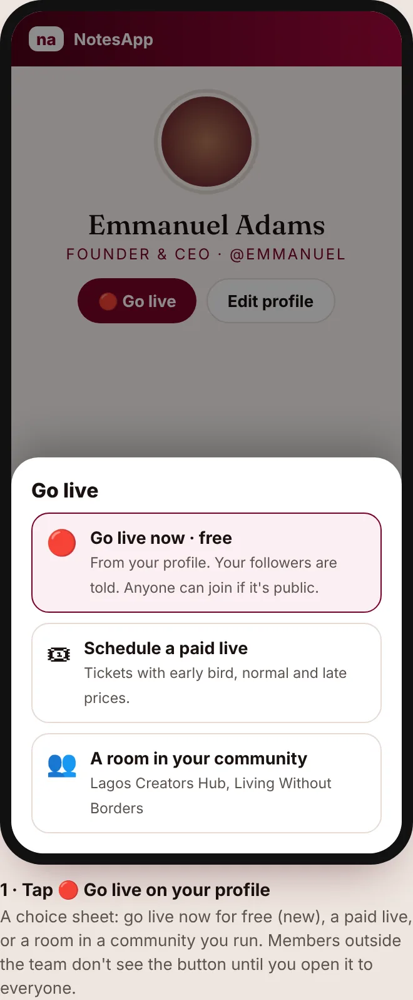
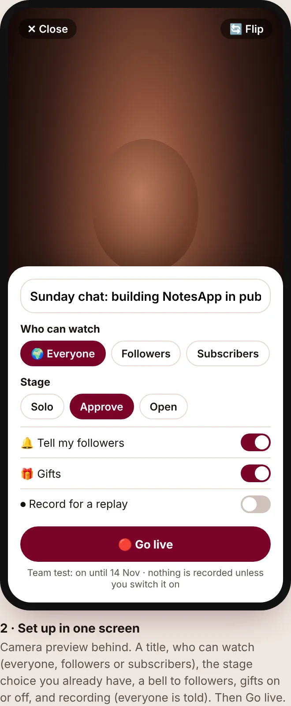
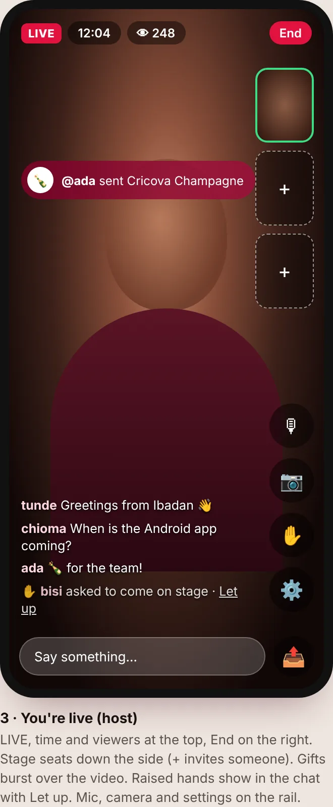
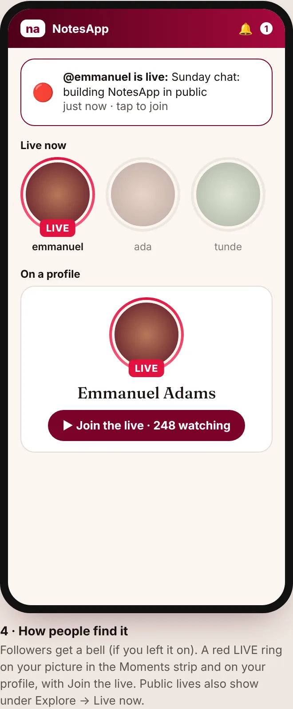
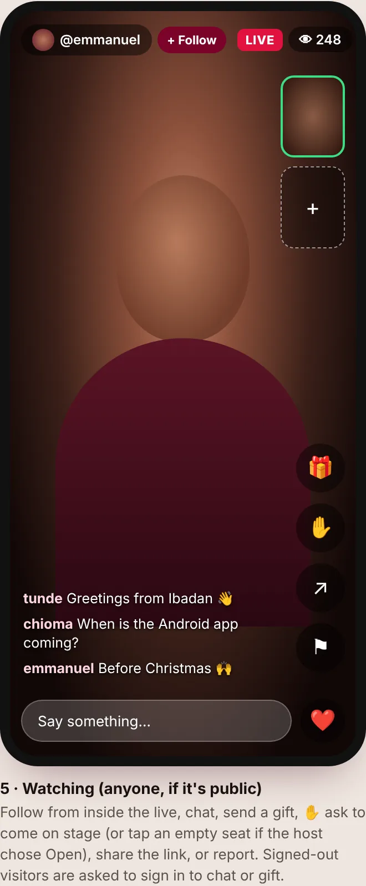
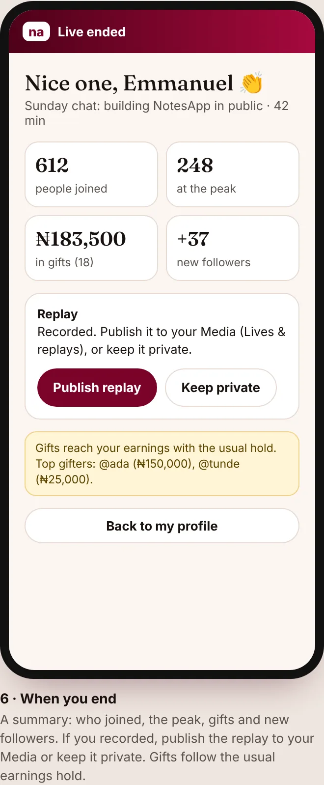

# 🔴 Go live from your profile

A free live straight from a member's profile: no ticket and no community. It runs on the rooms that community lives and paid lives already
use (`lib/rooms-server.ts`): audio, video through the relay, the poster, chat, gifts, the stage (Solo / Approve / Open), recording and
replays. The owner approved the six mockups as drawn (7 Nov 2026) and it was built in v0.152.0 (branch `push/golive-profile`).

## Who can start one, and who can join

- **Starting a live** (the 🔴 Go live button, and the server when a live is opened): only **#NotesApp team accounts**, and only while a super
  admin has the **staff test pass** on (Admin → Limits, always with an end date, at most 30 days; `lib/staff-pass.ts`). The server checks
  `hasStaffPass` (pass on, and a team account by `isTeamMember`). Everyone else sees no button; `/lives/start` tells them it's coming soon.
  Owner, 7 Nov 2026: "the gate is to stop non-team members from starting a live". When the owner opens it to everyone, this rule changes in
  one place.
- **Joining:** anyone can join a live its host made public (Everyone). Followers-only and subscribers-only lives are for those people.
  Signed-out visitors can watch a public live and are asked to sign in to chat or send a gift.
- Paid lives (`/lives`) and community rooms are not changed by this gate.

## What already shipped (v0.151.0, PR #304)

- 🔴 Go live on the profile (Media tab), in the Media studio (Lives & replays) and in the account menu, for the team while the pass is on.
- `/lives/start`: a paid live (Schedule a paid live, and the host's scheduled ones), or a room in any community the member owns, runs or
  moderates (`?start=room` opens the community's Start a room form).

## The mockups

The six screens, also as one sheet: [all-screens.webp](mockups/go-live/all-screens.webp) (HTML source: [mockups.html](mockups/go-live/mockups.html)).

### 1. Tap 🔴 Go live on your profile

A choice sheet: **Go live now · free** (new), **Schedule a paid live**, or **A room in your community** (listing the ones they run).

### 2. Set up in one screen

Camera preview behind. A title; **who can watch** (Everyone, Followers, Subscribers); the **stage** choice (Solo, Approve, Open); **Tell my
followers** (a bell); **Gifts** on or off; **Record for a replay** (everyone in the live is told). Then **Go live**. While the team test
runs, a line shows when the pass ends.

### 3. You're live (host)

LIVE, the time and the viewer count at the top, **End** on the right. Stage seats down the side (+ invites someone). Gifts burst over the
video (the Cricova Champagne video plays for that gift). Raised hands show in the chat with **Let up**. Mic, camera, hand queue and settings
on the rail.

### 4. How people find it

Followers get a bell (if the host left it on). A red **LIVE** ring on the host's picture in the Moments strip and on their profile, with
**Join the live** and the number watching. Public lives also show under Explore → Live now.

### 5. Watching

Follow from inside the live, chat, send a gift, ✋ ask to come on stage (or tap an empty seat if the host chose Open), share the link, or
report.

### 6. When the host ends it

A summary: people who joined, the peak, gifts (and the top gifters) and new followers. If it was recorded: **Publish replay** to the Media
(Lives & replays) or **Keep private**. Gifts reach earnings with the usual hold.

## Not in the first version

A live together with another creator (split screen), live shopping, and scheduling a free live ahead. Each can come later.

## Built (v0.152.0)

- Server: `lib/profile-lives-server.ts` (start, followers' bell, Live now, a profile's live, the lobby, the summary); rooms-server
  `mayEnter` and `startProfileRoom`; `GET/POST /api/lives`. Tests: `test:profile-lives-server`.
- Screens: the setup on `/lives/start` (screen 2, defaults Everyone and recording off, as drawn), the room (screen 3/5, with Follow), Live
  now on the feed and Explore and Join the live on profiles (screen 4), `/live/[id]` (the lobby), the summary (screen 6).
- Owner steps: deploy the Firestore indexes (`firebase deploy --only firestore:indexes`, for new followers in the summary); switch the staff
  test pass on to try it.
- Differences from the mockups: signed-out visitors are asked to sign in before joining (rooms are read by signed-in members only); the
  LIVE ring sits in a Live now row just above the Moments strip rather than inside it.
