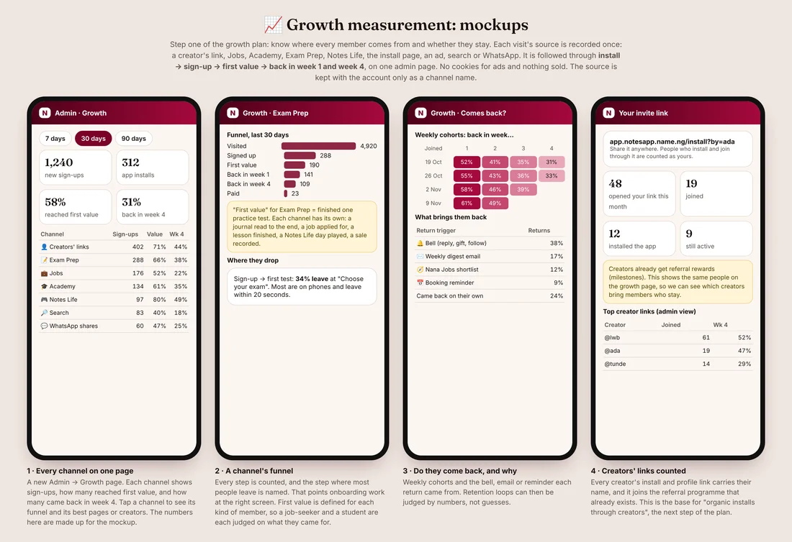

# Growth: measuring where members come from and whether they stay

> Status: **step 1 built in v0.171.0** (branch `push/growth-measure`). The owner approved the mockups on 15 November 2026
> ([mockups](mockups/growth/mockups.html), all four screens in [all-screens.webp](mockups/growth/all-screens.webp)).

## The six-step growth plan

| Step | What | Status |
|---|---|---|
| 1 | **Measurement.** Know where every member comes from (a creator's link, Jobs, Academy, Exam Prep, Notes Life, the install page, an ad, search or WhatsApp) and follow them through install → sign-up → first value → back in week 1 and week 4 → paid, on Admin → Growth. | **Built (v0.171.0)** |
| 2 | **Install-page positioning.** What the install page says, and to whom. | Next |
| 3 | **Creator-led installs.** Creators share their invite link; organic installs through creators. | Planned |
| 4 | **The install page converting.** More visitors to the install page actually install. | Planned |
| 5 | **Onboarding to value fast.** Shorten the step where most people leave, per channel. | Planned |
| 6 | **Retention loops.** Bells, the digest, reminders and shortlists that bring members back. | Planned |

Every later step is judged against the numbers step 1 records: the channel table and funnel for steps 2 to 5, Creator links for step 3,
the weekly cohorts and "What brings them back" for step 6. Measuring began with v0.171.0: members who joined before it have no source and
aren't in the numbers.

## What is recorded

### First touch (the channel)

On a visitor's first page on one of our addresses (`middleware.ts`, `firstTouch`), where they came from is worked out once, from
first-party data only, and kept in the `na_src` cookie (httpOnly, 30 days, the same length as the referral cookie, shared by the main,
app, Notes Life and Exam Prep addresses of one domain). Pages only: never API calls, files, prefetches, known bots, the admin area or
members' own domains. The rules are `classifyTouch` in `lib/growth.ts`, in this order:

1. **Creators' links:** `?by=<username>` on any page (the invite link is `app.<domain>/install?by=<username>`), a referral link
   `/r/<username>`, or a creator's profile or site (`/u/<username>`, `/s/<username>`). Detail: the username.
   `?by=` also sets the referral cookie, exactly like `/r/<username>` (the latest link wins), so the referral programme treats it the same.
2. **Ads:** `utm_medium` of `cpc`, `ppc`, `paid…`, `display` or `ads`. Detail: `utm_campaign` (or `src`, or `utm_source`).
3. **`?src=<channel>`** naming a channel (`?src=whatsapp`). Any other `?src=` is a campaign tag kept as the detail.
4. **The product landed on:** `/jobs` and `/nana-jobs` → Jobs; `/academy` → Academy; `/exam-prep` and the `prep.` address → Exam Prep;
   `/life` and the `life.` address → Notes Life; `/install` → Install page.
5. **The referring site's host name:** search engines → Search; WhatsApp → WhatsApp shares; Facebook, Instagram, X, LinkedIn, TikTok,
   YouTube → Social (the same host lists as member analytics, `sourceOf` in `lib/analytics.ts`).
6. Otherwise **Direct** (typed in, saved, our own pages, or another site, whose host name is the detail).

The referring source is kept too (`via`), so "Academy, found through search" can be told apart later.

At sign-up (the existing `POST /api/referrals {action: "claim"}`, which `SignupFlow` already calls) the account gets
`growthMembers/{uid}`: the channel, the detail and when they joined. A new account that signed up some other way gets it on its first
daily "seen" (below), within its first week. **Teens and children keep the channel only**: no detail, so no creator ever counts them.

### Installs

The app installs from the browser (`app/manifest.ts`, the install page `app/install` → `components/InstallGuide.tsx`; the store apps in
`docs/MOBILE-APPS.md` will wrap the same app with Capacitor). There is a reliable signal, so installs are **counted, not clicks**:

- the browser's `appinstalled` event (Chrome, Edge, Android), and
- the installed app's **first open on this device** (display-mode standalone, iOS's `navigator.standalone`, or Capacitor's
  `isNativePlatform` once the store apps exist), once per device (`components/GrowthBeat.tsx`).

Each counts once into `growthDaily/{yyyymmdd}.installs.<channel>` with the visitor's channel, and a signed-in member's account gets
`installedAt` once. Installed before joining: the `na_inst` cookie gives the account `installedAt` when they sign up. Known limit: an
iPhone's home-screen app starts with its own empty cookies, so an iPhone install opened before signing in counts as Direct.

### New visitors and creator-link opens

The middleware can't write to the database, so it sets a short readable flag (`na_ping`: `v` for a new visitor, `o` for a creator's link
opened); the page reports it once (`POST /api/growth {action: "visit"}`), which adds one to `growthDaily/{day}.visits.<channel>` and,
for an open, `growthCreators/{username}_{yyyymm}.opens`, then clears the flag. Members already signed in aren't new visitors.

### First value, per kind of member

The first time a member reaches each kind is recorded once, as `growthFirst/{uid}_{kind}` (a single `create`, remembered per server
instance so repeating it costs nothing). Where it is recorded:

| First value | Where | Kind |
|---|---|---|
| A journal read to the end | the bar under a journal comes into view (`SocialBar`), once per member per device; the server checks the journal is published and not theirs | `read` |
| A journal published | the journal form after a published save (journals are saved from the browser); the server checks they have a published journal | `journal` |
| A job applied for (Notes Jobs) | `POST /api/jobs/apply` | `job` |
| A Nana Jobs shortlist viewed | `GET /api/jobs/nana` when a shortlist exists | `shortlist` |
| One Academy lesson finished | `POST /api/academy/progress` (done) | `lesson` |
| One Exam Prep practice test finished | `POST /api/exam-prep/mock/<id>` (signed-in students; offline mocks aren't counted) | `exam` |
| One Notes Life day played | `POST /api/life` once the player's game has run a game day | `life` |
| A Business books sale recorded | `POST /api/books {action: "sale"}` | `sale` |
| A booking made | `fulfillPayment` for a paid booking (`lib/payments.ts`) | `booking` |
| A community post or reply | `POST /api/community` post or comment | `community` |

**Definitions.** A member who came through a product channel is judged on that product (`VALUE_FOR`): Exam Prep → a practice test
finished; Jobs → a job applied for or a shortlist viewed; Academy → a lesson finished; Notes Life → a day played. Everyone else reaches
first value with any of them.

### Returns

Presence (`presence/{uid}`) only keeps the latest beat and members can switch it off, so it can't say which weeks someone came back. A
signed-in member's page marks them **seen** once a day (`POST /api/growth {action: "seen"}`, one read and at most one write per member
per day, only for members with a growth record). A day after the day they joined is a **return**:

- **Week n** is days 7n to 7n+6 after joining: week 1 is the second week, week 4 is days 28 to 34. The weeks they came back in are kept.
- **What brought them back** is the `?r=` on the first page of that visit: `bell` (the bell's links, `NotificationBell`), `push` (phone
  notifications, `lib/push-server.ts`), `digest` (the weekly digest's links, `lib/digest.ts`), `reminder` (booking reminders in
  `/api/cron/reminders`, event reminders in `lib/events-server.ts`), `nana-jobs` (the shortlist's bell and email). Anything else is
  **came back on their own**. Returns are counted up to the end of week 4.
- **Still active:** seen in the last 14 days.

### Paid

Any successful payment by the member after joining (`payments` with a paid status, or refunded later), any kind.

## Admin → Growth

`/admin/growth`, in the admin menu's Growth group (Marketing, Sales & partnerships and Finance; super admins see everything). Four views, as drawn:

1. **Every channel:** 7, 30 or 90 days; tiles for new sign-ups, app installs, % reached first value and % back in week 4; a table by
   channel (sign-ups, value, week 4). Tap a channel for its funnel.
2. **Funnel:** visited → signed up → first value → back in week 1 → back in week 4 → paid, with the step where the biggest share leaves.
   The week steps count only members whose week is over; the page says how many are too new.
3. **Comes back?:** the last eight weekly cohorts (by the Monday of the week they joined) with % back in weeks 1 to 4, each shown once
   it's over for the whole cohort, and "What brings them back".
4. **Creator links:** joined, installed and still active (members who joined in the range) and week 4 (everyone they brought whose week 4 is over) for the top creators, joining the referral programme (`referrals`) with
   first touch (`?by=` without a referral claimed). Teens and children never appear.

**Week 4 on the overview** is for members who joined in a range as long as the one chosen, ending five weeks ago, so everyone in it has
had their week 4.

The numbers are counted at most once an hour into `statCache/growth` (`lib/stat-cache.ts`, as `lib/traction-server.ts` does), from
`growthMembers` (joined in the last 125 days), `growthFirst`, `growthDaily` (91 small reads), `payments` and `referrals` by date. Opening
the page costs one read. **Count again now** rebuilds it.

## The member's "Your invite link" card

On **My account → Growth → Referrals** (the account menu, `lib/account-nav.ts`) (`components/InviteLinkCard.tsx`): their link `app.<domain>/install?by=<username>` and their own numbers:
opened this month, joined (through the invite link, their `/r/` link or their code), installed the app, still active. Numbers only,
never who. Help article: `invite-link`.

## Privacy

- First-party only: our own cookie and our own server. No ad network, pixel or third-party analytics; nothing sold or shared.
- Kept with the account: the channel name and a small detail (a creator's username, a campaign tag or a referring host name). Never an
  IP address, a full address, a search term or anything that names the visitor.
- Teens (13 to 17) and child profiles: the channel only. They are never shown to creators, by name or in counts.
- Creators see counts only, never who joined through them. Staff see counts and creators' usernames only.
- All growth collections are server-only (`firestore.rules`, covered by `npm run test:rules`), and closing an account deletes its
  `growthMembers` and `growthFirst` records (`lib/account-server.ts`).
- The Privacy Policy (`/privacy`, "Cookies and storage") says so in one paragraph.

## Code and tests

- Rules (pure): `lib/growth.ts`. Server: `lib/growth-server.ts`. Browser: `components/GrowthBeat.tsx` (root layout),
  `lib/growth-client.ts`, `components/InviteLinkCard.tsx`. Routes: `app/api/growth` (visit, install, seen, value; GET your invite
  numbers), `app/api/admin/growth`. Page: `app/(main)/admin/growth`. First touch: `middleware.ts` (`firstTouch`).
- `npm run test:growth` (pure: channel mapping, the cookie, return tags, first value, weeks, cohorts, the funnel, the report, digest tags).
- `npm run test:growth-server` (emulator: sign-up source, first values, visits, installs, returns, the snapshot, invite numbers, closing).

## Owner steps

1. `firebase deploy --only firestore:rules` (server-only rules for `growthMembers`, `growthFirst`, `growthDaily`, `growthCreators`).
   No new composite indexes: every query is on one field.
2. Give the staff who should see it Marketing, Sales & partnerships or Finance (Admin → Team access); super admins already can.
3. Nothing else: no settings, keys or outside services. Numbers start from the day it ships; give it five weeks before week 4 means much.
