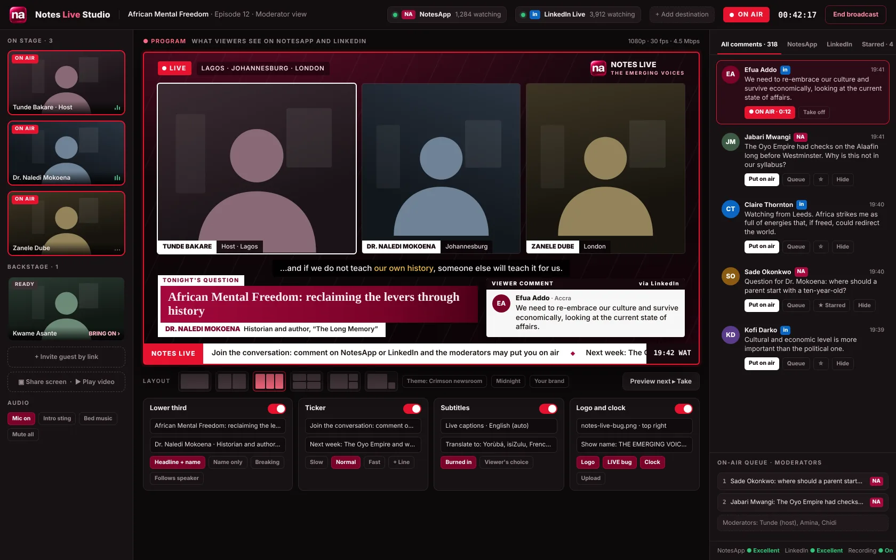

# 🎬 Notes Live Studio

A broadcast studio over a live on NotesApp: a logo, a lower third, a scrolling ticker, subtitles, viewers' comments on air, clips, a
sponsor spot, and roles for the team running the show. The owner asked for it on 15 Nov 2026 from a LinkedIn Live screenshot ("like
this but better … a CNN/BBC standard broadcast"), approved the mockup below the same day ("everything is perfect"), and it was built
in v0.177.0 (branch `claude/festive-lovelace-r64np9`).

The programme viewers see: [programme-mockup.webp](mockups/studio/programme-mockup.webp) (HTML source: [mockup.html](mockups/studio/mockup.html)).

## How it works

The studio does **not** mix a new video on a server. A live room already carries the sound and the cameras (`lib/rooms.ts`, the
Cloudflare relay). The studio adds one small object to the room's document, `communityRooms/{id}.studio` (`lib/studio.ts`
`StudioState`): the layout, theme, logo, lower third, ticker, subtitle line, the comment on air, the queue, the clip playing and the
sponsor spot. Every screen in the room draws the same programme from it (`components/studio/ProgramFrame.tsx`), sized in container
units so it is identical on a phone and a desktop. Words stay sharp on a weak connection, it costs nothing extra to send, and a change
is one write to the room.

Every change goes through the server: `POST /api/community/rooms { action: "studio", id, op, … }` → `studioStep`
(`lib/rooms-server.ts`), which checks who may, cleans what was typed (`applyStudioPatch`, `cleanComment`), and writes the room in a
transaction. Moderators' and editors' steps go in the moderators' log.

| op | What | Who |
|---|---|---|
| `on` | Switch the studio on or off | The host |
| `set` | Layout, theme, who is in focus, logo and badges, lower third, ticker, subtitle line, sponsor spot | `studio` |
| `clip` | Play a clip for everyone, or stop it | `studio` |
| `comment` | Put a viewer's comment on air, or take it off | `onair` |
| `queue` / `unqueue` | The on-air queue (10 at most) | `onair` |
| `screen` | "My video track is now my screen" (or no longer is) | Someone on stage |

## Roles

The owner asked for host, editor, guest, moderator and viewer privileges. They sit on the room's existing permissions
(`lib/rooms.ts` `MOD_PERMS`), with two new ones, `studio` and `onair`, and a new **Editor** preset beside Basic and Full.

- **Host:** everything; the only one who switches the studio on or off and names editors and moderators (🛡 Moderators in the room).
- **Editor** (preset: pin, poster, `studio`, `onair`): runs the picture. No say over people.
- **Moderator:** the chat and stage powers they already had; with `onair`, puts comments on air. Full includes both new permissions.
- **Guest:** on stage. Microphone, a camera when the host lets speakers use video, and then **🖥 Share screen** too.
- **Viewer:** watches and comments. A comment may be chosen for the air.

## What is in v0.177.0

- **Programme:** layouts Auto, Solo, Spotlight, Grid, Picture in picture; themes Crimson newsroom, Midnight, Ivory. A person whose
  camera is off shows as their picture on a tile, with a name strap; whoever is speaking is outlined.
- **Logo and badges:** the NotesApp mark or an uploaded logo, a show name, a LIVE badge, a "where from" strip, a clock.
- **Lower third:** a small line above, a headline, the speaker's name and who they are; styles Headline + name, Name only, Breaking.
- **Ticker:** up to 8 lines scrolling along the bottom, a tag, three speeds.
- **Subtitle line:** typed by the editor (what was said, or a translation), shown until cleared.
- **Comments on air:** **On air** and **Queue** beside each chat message for those holding `onair`. Where the room keeps its chat in
  Firestore the server uses the chat's own copy, so nobody is quoted saying something they didn't; on the live-rooms worker (chat not
  stored) the moderator's copy is used and their name is in the log.
- **Clips:** an intro, an outro, a video or sound in between, or a picture (a slide, a title card). Uploaded to the editor's own
  `studio/` folder (`POST /api/studio/upload`: MP4/WebM up to 100 MB, MP3/M4A/WAV/OGG up to 20 MB; pictures go up as posters do). A
  clip plays on every screen from where it has reached, so a late joiner is in step. Videos can be marked as a full-screen
  **Advertisement**.
- **Sponsor spot:** a picture (it may be animated) or a video, always without sound, as a corner card or a banner above the ticker.
- **Screen share:** a guest's or host's screen in place of their camera on the same video track; the programme shows it large and whole.
- **Try it:** `/studio` has the real programme and desk working on that screen only.

Files the studio shows must be in our own storage, in the folder of the person setting them (`ownStudioFile`): never an outside address.

## The gate

While the team tests it, the studio can be switched on only in a live started on the **staff test pass** (`room.staffPass`,
`lib/staff-pass.ts`), like 🔴 Go live itself, and clip uploads need the pass too. Opening it to everyone is one switch:
`STUDIO_FOR_EVERYONE` in `lib/studio.ts`.

## Not in this version

- **LinkedIn Live at the same time** (owner: "notesapp first is ok, LinkedIn says coming soon"; the desk shows *LinkedIn Live · coming
  soon*). The plan: the room recorder (`services/room-recorder`, headless Chromium) opens a page that draws the programme, and ffmpeg
  pushes it to LinkedIn's RTMP address. That needs the owner's page approved for LinkedIn Live (stream URL and key); bringing LinkedIn
  comments into the chat needs their Live Events API access, granted separately.
- **Graphics in the recording.** A recorded live keeps the stage's sound and picture as before; the studio's graphics and clips are
  not in the replay yet. The same programme page fixes both this and LinkedIn.
- **Automatic subtitles from speech**, and translation.
- **Background blur, crop or replacement** on a camera.
- **Ads from the NotesApp ad network** in the sponsor spot and ad breaks (today the editor uploads the sponsor's file).
- **Sharing a document** other than as a picture or a shared screen.
- A clip's sound is played on each screen, not mixed into the relay: stage microphones stay live under it (mute while it plays).

## Owner steps

None to deploy: no new rules, indexes or settings (the room document is server-written already). To try it: switch the staff test
pass on (Admin → Limits), start a live from a team account, tap **🎬 Studio** → **Switch the studio on**. Name an editor in
**🛡 Editors and moderators** (the Editor preset).

## Tests

`npm run test:studio` (the pure rules) and `npm run test:rooms-server` (`tests/community/studio.emulator.ts`: the gate, each role,
files, comments, the queue, clips, the shared screen).
